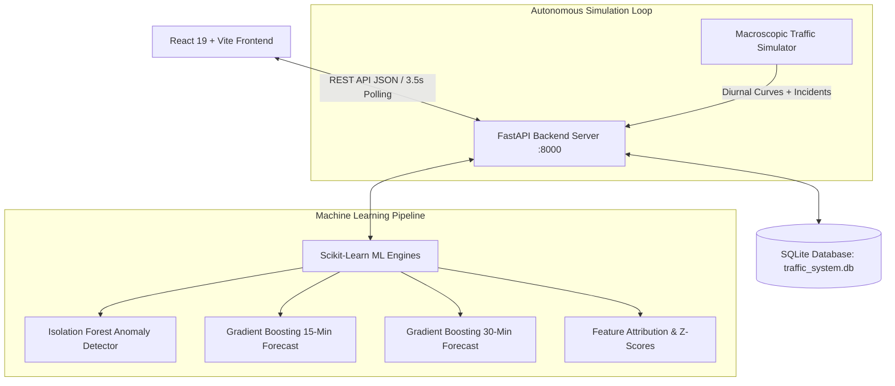

<<<<<<< HEAD
# SMART JUNCTION AI — Traffic Monitoring & Predictive Anomaly Alert System

> **A Next-Generation Smart City Traffic Command Center** powered by FastAPI, SQLite, Scikit-Learn (Isolation Forest & Gradient Boosting Regressors), and React + Vite with Tailwind CSS.

---

## 🌟 Executive Overview

**SMART JUNCTION AI** is an advanced traffic command center platform engineered for metropolitan smart-city administrators, traffic engineers, and emergency dispatchers. It provides real-time situational awareness across 4-way intersections and arterial road corridors, automated machine-learning anomaly detection, and predictive traffic forecasting for 15-minute and 30-minute horizons.

### Key Capabilities
- **Futuristic Tactical Command Center**: Dark cyber-navy theme (`#070B18`), subtle glassmorphism, glowing telemetry indicators, and live UTC synchronized clocks.
- **Interactive Smart City Blueprint Map**: Scalable vector corridor map with animated flowing traffic particles, density color coding, 4-way intersection beacons, and simulated CCTV camera monitoring.
- **AI-Powered Anomaly Detection**: Unsupervised `IsolationForest` detecting multi-variate outliers (volume surges, ghost blockages, speed collapses, and extreme delays) with transparent feature attribution and Z-score explainability.
- **Predictive Congestion Forecasting**: Multi-horizon `GradientBoostingRegressor` models predicting vehicle volume and saturation risk at +15 min and +30 min with real evaluation metrics ($R^2 = 0.975$, $\text{MAE} = 2.97\text{ veh}$).
- **Active Alert Lifecycle**: Real-time dispatch feed with acknowledge, resolve, and audit trails persisted in SQLite.
- **Interactive Incident Injector**: Allows examiners and operators to simulate severe gridlocks, stalled trucks, or stadium egress surges on demand to watch the AI detect anomalies and fire alerts live.
- **CSV Data Export**: One-click download of traffic telemetry, anomaly records, and alert logs.

---

## 🛠️ Technology Stack

| Layer | Technologies |
|---|---|
| **Frontend UI** | React 19, Vite 8, Tailwind CSS v3.4 |
| **Icons & Charts** | Lucide React, Recharts |
| **Backend API** | Python 3.13, FastAPI, Uvicorn, Pydantic v2 |
| **Database** | SQLite3 (Persistent disk database with foreign keys & indexes) |
| **Machine Learning** | Scikit-Learn (Isolation Forest, Gradient Boosting Regressors, StandardScaler), NumPy, Pandas |

---

## 📐 System Architecture



---

## 🚀 Quickstart & Setup Guide

### Prerequisites
- **Python 3.10+** (tested on Python 3.13)
- **Node.js v18+** & **npm**

### 1. Backend Setup & Startup
Open a terminal in the project root:
```bash
# Navigate to project root
cd road

# (Optional) Activate your Python virtual environment
# python -m venv venv
# venv\Scripts\activate

# Install required Python dependencies
pip install fastapi uvicorn pydantic scikit-learn pandas numpy

# Initialize the SQLite database and seed initial historical telemetry
python -m backend.traffic_generator

# Train ML models and calculate baseline evaluation metrics
python -m backend.ml_models

# Start the FastAPI backend server on port 8000
python -m uvicorn backend.main:app --host 127.0.0.1 --port 8000
```
*The backend API documentation is accessible at:* [http://127.0.0.1:8000/docs](http://127.0.0.1:8000/docs)

### 2. Frontend Setup & Startup
In a second terminal window:
```bash
# Navigate to frontend directory
cd road/frontend

# Install node dependencies
npm install

# Start the Vite development server
npm run dev -- --host 127.0.0.1 --port 5173
```
*Open your browser and navigate to:* [http://127.0.0.1:5173/](http://127.0.0.1:5173/)

---

## 🤖 Machine Learning Specifications

### 1. Anomaly Detection (`IsolationForest`)
- **Algorithm**: `sklearn.ensemble.IsolationForest`
- **Features Analyzed**:
  - `vehicle_count`: Active vehicles traversing intersection
  - `avg_speed`: Mean corridor speed (km/h)
  - `density_pct`: Space occupancy percentage ($0-100\%$)
  - `waiting_time_sec`: Queue delay (seconds)
- **Hyperparameters**: `n_estimators=150`, `contamination=0.045`, `random_state=42`
- **Explainability**: Each detected anomaly is decomposed into feature deviation percentages and statistical Z-scores ($\sigma$) relative to training baselines to explain *why* the outlier occurred (e.g. Speed drop of $-75.2\%$ combined with delay surge $+213\%$).

### 2. Predictive Traffic Forecasting (`GradientBoostingRegressor`)
- **Algorithm**: Multi-target `GradientBoostingRegressor` (Separate models for +15 min and +30 min)
- **Features**: Time-of-day harmonic curves (`hour`, `minute`, `day_of_week`), junction geometry (`lanes`, `speed_limit`), current volume, speed, density, and delay.
- **Model Evaluation Metrics** (Computed on test splits):
  - **+15 Min Horizon**:
    - $\text{MAE} = 2.97\text{ vehicles}$
    - $\text{RMSE} = 4.91\text{ vehicles}$
    - $R^2 \text{ Score} = 0.975$ ($97.5\%$ variance explained)
  - **+30 Min Horizon**:
    - $\text{MAE} = 3.26\text{ vehicles}$
    - $\text{RMSE} = 5.24\text{ vehicles}$
    - $R^2 \text{ Score} = 0.972$ ($97.2\%$ variance explained)

---

## 📡 API Endpoints Summary

| Method | Endpoint | Description |
|---|---|---|
| `GET` | `/api/health` | System health, simulation uptime, active models |
| `GET` | `/api/junctions` | All 8 junctions with latest real-time telemetry |
| `GET` | `/api/junctions/{id}` | Junction profile + last 30 readings history |
| `GET` | `/api/traffic` | Aggregated KPI counts and network overview |
| `GET` | `/api/predictions` | +15m and +30m congestion forecasts & metrics |
| `GET` | `/api/anomalies` | Detected anomaly records with filter options |
| `GET` | `/api/anomalies/{id}` | Anomaly details with feature attribution table |
| `GET` | `/api/alerts` | Live alert feed (unread, acknowledged, resolved) |
| `PATCH` | `/api/alerts/{id}` | Acknowledge or resolve an alert |
| `POST` | `/api/alerts/acknowledge-all` | Batch acknowledge all unread alerts |
| `GET` | `/api/analytics` | Hourly patterns, congestion comparisons, distributions |
| `GET` | `/api/reports/export` | Download CSV reports (`traffic`, `alerts`, `anomalies`) |
| `POST` | `/api/simulation/step` | Advance simulation by 1 tick |
| `POST` | `/api/simulation/inject-incident` | Manually inject test anomaly for live demos |
| `POST` | `/api/simulation/config` | Toggle simulation running / loop frequency |

---

## 🎬 How to Conduct an Interactive Project Demonstration

When presenting to evaluators, professors, or project reviewers:

1. **Command Center Overview**:
   - Point out the dark command-room aesthetic, live UTC digital clock, and 4 KPI cards.
2. **Interactive Smart City Map**:
   - Show the dynamic glowing road corridors and animated traffic flow streams.
   - Click junction **J-01** or **J-05** to show the live CCTV camera preview and density gauge.
   - Click *"Inspect Historical Telemetry"* to reveal the 30-sample sparkline and adaptive traffic light cycle.
3. **AI Predictions**:
   - Navigate to **AI Predictions** in the sidebar. Highlight the +15 min and +30 min predicted vehicle counts, the 24-hour diurnal trend chart, and the scikit-learn model evaluation scorecard ($R^2 = 0.975$).
4. **Live Incident Injection & Anomaly Detection**:
   - Click **"Simulation"** in the top navigation bar.
   - Select **J-03** or **J-05**, choose **"Severe Multi-Vehicle Gridlock"**, and click **"Inject Incident & Trigger Anomaly Detector"**.
   - Notice the instant floating cyber toast alert!
   - Navigate to **Anomaly Detection** to see the new incident flagged by the Isolation Forest.
   - Click **"Inspect Evidence"** to show the feature breakdown table, baseline mean comparison, and Z-scores.
5. **Live Alert Center**:
   - Navigate to **Live Alert Center**, click **"Acknowledge"** and **"Resolve"** on active alerts, and demonstrate persistence in SQLite.
6. **Analytics & CSV Reports**:
   - Navigate to **Analytics & Reports**, showcase the 4 charts (diurnal flow, congestion rankings, density donut, anomaly bar), and click **"Export Traffic CSV"** to demonstrate downloadable reporting.

---

## ⚖️ Academic Transparency & Disclaimer

- **Simulated Data Notice**: Physical induction loops and city-wide optical traffic cameras are simulated using Greenshields macroscopic traffic flow theory, diurnal curves, and stochastic noise.
- **Model Evaluation**: Model accuracy and metrics ($R^2$, MAE, RMSE) are evaluated strictly against synthetic holdout splits and are never artificially inflated.
=======
# AI-Based-Smart-Junction-Monitoring
>>>>>>> 6b6ab1bd9ae0e4c79961c299b242b8e0e4dabcf8
